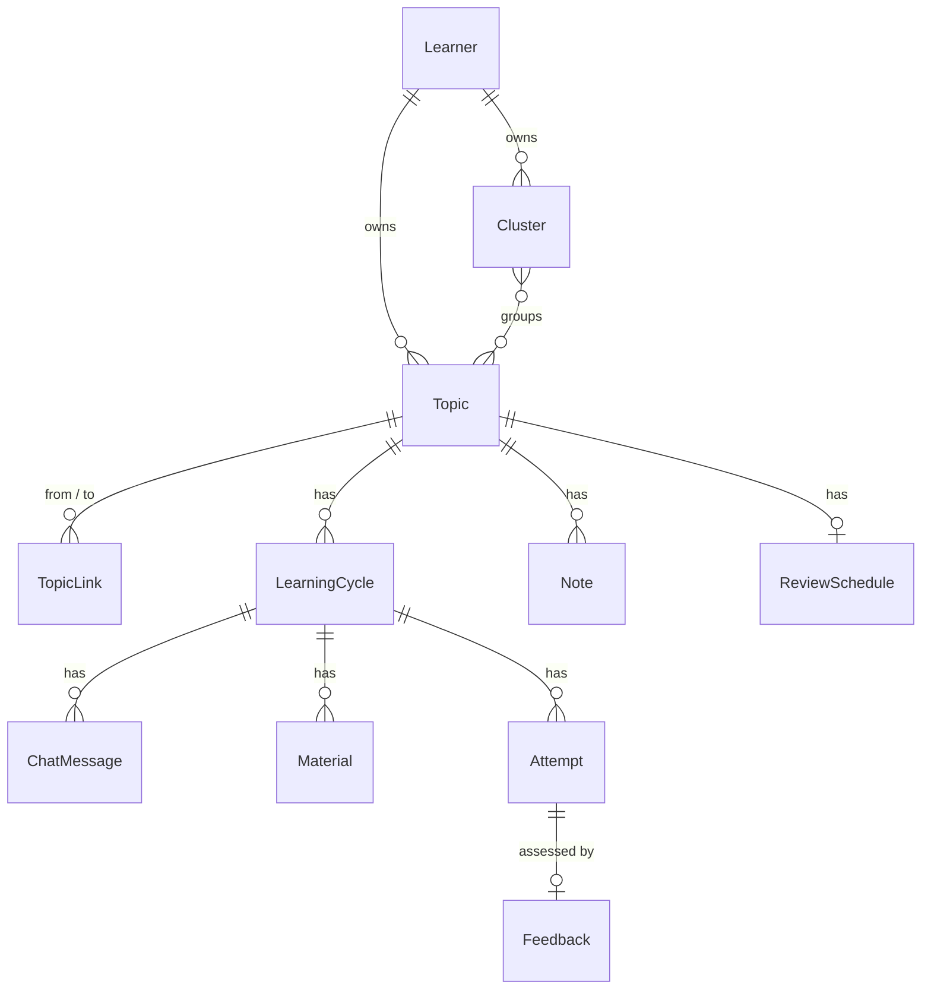

# Domain model

The core concepts of ai-tutor, how they relate, and the rules they must keep. This is a design document: names and fields may change when the code is written, but the rules should not change silently.

## Overview



## Learner

The person learning. Local mode has a single default learner; remote mode has one per account (#13). Every record below is owned by exactly one learner, through its topic.

- `id`
- `settings.default_method`: the learning method new cycles start with (see [Learning methods](#learning-methods)).
- `settings.strict_order`: whether cycles follow the stage order strictly (see [LearningCycle](#learningcycle)).

## Topic

Anything the learner wants to learn, as broad or narrow as they like.

- `id`, `owner_id`, `title`, `description`, `created_at`
- Topics are flat, like notes in Obsidian: there is no parent or folder tree. Structure comes from links and clusters.
- `title` is unique per learner, ignoring case, because it is the topic's file name and wikilink target in the vault.

### TopicLink

A directed edge between two topics of the same learner. In the vault it becomes a wikilink.

- `from_topic_id`, `to_topic_id`, `kind`: `prerequisite` or `related`
- `prerequisite`: *from* must be learned before *to* (Algebra → Calculus).
- `related`: symmetric. Stored once; read in both directions.

### Cluster

A named group of topics. Learners see and manage clusters as hashtags (`#calculus-exam`); in the vault they become tags. A topic can belong to any number of clusters.

- `id`, `owner_id`, `name`
- members: a set of topic ids

## LearningCycle

One pass through a topic. A topic can have many cycles over time: the first time it is learned, a relearn, a review. Old cycles are kept so the learner can see how their understanding changed.

- `id`, `topic_id`, `started_at`, `completed_at`
- `stages`: the ordered list of stages for this cycle, copied from the learning method when the cycle starts. Changing settings later does not change existing cycles.
- `current_index`: position in `stages`.
- `skipped`: indexes of stages the learner skipped.

Moving between stages depends on `settings.strict_order`:

- Off (default): the learner may move forward or back freely.
- On: the learner moves through stages in order. They can still skip the current stage; the skip is recorded in `skipped`.

Stages:

| Stage | Produces |
| --- | --- |
| `chat` | ChatMessage |
| `materials` | Material |
| `quiz` | Attempt |
| `feedback` | Feedback |
| `notes` | Note |
| `review` | ReviewSchedule update |
| `next_topic` | a suggested Topic (created only if the learner accepts it) |

A stage may appear more than once in `stages` (for example, quiz before and after materials).

## Artifacts

Everything the learner produces or picks is an artifact. Artifacts are never deleted by the system.

### ChatMessage

- `id`, `cycle_id`, `role` (`learner` or `tutor`), `content`, `created_at`

### Material

A learning resource found during the cycle.

- `id`, `cycle_id`, `kind` (`video`, `article`, `other`), `title`, `url`, `source`
- `picked`: whether the learner chose to study it
- `created_at`

### Attempt

The learner's answer to a blank quiz: what they can recall, from memory.

- `id`, `cycle_id`, `prompt`, `created_at`
- `answer_text`: optional
- `photo_keys`: storage keys of uploaded photos (handwritten work). Files live behind the storage port.
- At least one of `answer_text` or `photo_keys` is present.

### Feedback

The assessment of one attempt.

- `id`, `attempt_id`, `created_at`
- `known`: what the learner showed they understand
- `missing`: gaps and misconceptions
- `next_questions`: questions the learner should now be able to answer

### Note

The learner's progress record on a topic. Notes belong to the topic, not the cycle, so they accumulate across cycles.

- `id`, `topic_id`, `cycle_id` (optional: the cycle that produced it), `body`, `created_at`, `updated_at`

### ReviewSchedule

When the topic should be recalled again. One per topic.

- `topic_id`, `due_at`, `interval_days`, `last_reviewed_at`
- Doing a review starts a new LearningCycle with the `review` method. Its result updates the schedule. The algorithm is decided in #10.

## Learning methods

A learning method is a named stage order. The learner picks a default in settings and can override it per cycle. Methods are presets defined in code; learners don't define their own.

| Method | Stages | Why |
| --- | --- | --- |
| `standard` | chat → materials → quiz → feedback → notes → review → next_topic | The default cycle. |
| `pretest` | chat → quiz → feedback → materials → quiz → feedback → notes → review → next_topic | Trying to recall before studying improves later learning (pretesting effect), and shows the learner what they already know. |
| `review` | quiz → feedback → notes → review | Spaced review of a topic already learned. |

## Markdown vault

Notes and study history are also written as Markdown files, so the learner can browse them on their own in Obsidian or any editor.

- The database is the source of truth. The vault is a one-way copy, rewritten whenever an artifact changes. Edits made in the vault are not read back.
- Local mode writes the vault to a folder on disk. Remote mode offers it as a download.
- Files are written through a port, like database and storage.

Layout:

```
vault/
├── Limits.md
├── Derivatives.md
└── cycles/
    ├── Limits 2026-10-12 standard.md
    └── Derivatives 2026-10-20 standard.md
```

Flat, like the topics. The structure lives in links and tags, so Obsidian's graph view and tag pane show it.

- **Topic file** (`<Topic>.md`): description, notes, and links to its cycles. Frontmatter holds the clusters as `tags`. Links become wikilinks: `Prerequisites: [[Limits]]`, `Related: [[Mechanics]]`.
- **Cycle file** (`cycles/<Topic> <date> <method>.md`): `Topic: [[Derivatives]]`, then the chat, the materials (picked ones marked), each attempt with its photos embedded, and its feedback, in stage order.

## Rules

1. Every learning record belongs to exactly one topic: directly (Note, ReviewSchedule) or through its cycle.
2. A topic's links and clusters belong to the same learner.
3. Topic titles are unique per learner, ignoring case.
4. `prerequisite` links form a DAG: no topic is, directly or indirectly, its own prerequisite. `related` links may form loops.
5. No duplicate links: at most one link of each kind between two topics.
6. Artifacts are never discarded. Deleting a topic is not supported until we decide how to archive it.
7. A cycle's `stages` never change after it starts.

## Open questions

- **Deleting and renaming topics.** Archive instead of delete? What happens to links when a topic is archived? Renaming changes the vault file name, so wikilinks in other files must be rewritten.
- **Note edits.** Notes are editable. Do we keep previous versions to satisfy "nothing vanishes"?
- **Confidence rating.** Ask the learner how confident they are before showing feedback, to train self-assessment?
- **Review algorithm.** Fixed intervals, SM-2, or FSRS (#10).
- **Two-way vault sync.** Read edits made in Obsidian back into the database?
