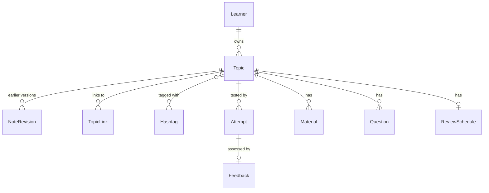

# Domain model

The core concepts of ai-tutor, how they relate, and the rules they must keep. This is a design document: names and fields may change when the code is written, but the rules should not change silently.

## Overview

ai-tutor is note-first. Each topic is one note that the learner writes. Everything else (tests, feedback, materials, questions, reviews) hangs off that note.



## Learner

The person learning. Local mode has a single default learner; remote mode has one per account (#13). Every record below is owned by exactly one learner, through its topic.

- `id`

## Topic

Anything the learner wants to learn, as broad or narrow as they like. A topic is a note: the learner writes it in their own words.

- `id`, `owner_id`, `title`, `body` (Markdown), `created_at`, `updated_at`
- Topics are flat, like notes in Obsidian: no parent and no folders. Structure comes from links and hashtags in the body.
- `title` is unique per learner, ignoring case, because it is the note's file name and wikilink target in the vault.
- The AI never writes `body`. It can insert a prompt for the learner to fill in (see [Material](#material)), but the content is the learner's.

### NoteRevision

The previous `body` of a topic, kept on every save that changes it, so editing a note never loses what was there.

- `id`, `topic_id`, `body`, `created_at`

### TopicLink

A link from one note to another, written as `[[Title]]` in the body.

- `from_topic_id`, `to_title`, `to_topic_id` (empty while unresolved)
- Parsed from the body on every save. The learner edits links by editing text, not through a separate form.
- A link to a title with no topic yet stays unresolved. Following it creates the topic.
- Read in both directions: a note shows its links and the notes that link to it (backlinks).

### Hashtag

A name that groups notes, written as `#calculus-exam` in the body. In the vault it becomes an Obsidian tag.

- `owner_id`, `name` (lowercase, words joined with `-`)
- Parsed from the body on every save, like links.
- A hashtag can be reviewed as a group.

## Study records

Everything the learner produces or picks is kept. The system never deletes these.

### Attempt

A Test me: the note is hidden and the learner writes what they remember.

- `id`, `topic_id`, `note_revision_id`: the note as it was when the test started. Feedback compares against this version, not a later edit.
- `answer_text`: optional
- `photo_keys`: storage keys of uploaded photos (handwritten work). Files live behind the storage port.
- At least one of `answer_text` or `photo_keys` is present.
- `created_at`

### Feedback

The AI's assessment of one attempt against the note.

- `id`, `attempt_id`, `created_at`
- `known`: what the learner recalled correctly
- `missing`: what the note has and the answer lacked, plus misconceptions
- `next_questions`: questions the learner should now be able to answer

The learner then fixes the note themselves. Feedback suggests; it does not edit the note.

### Material

A video, article, or other resource for a topic.

- `id`, `topic_id`, `kind` (`video`, `article`, `other`), `title`, `url`, `source`, `created_at`
- `found_for`: optional. The gap the search aimed at, such as a `missing` item from the last feedback.
- `saved`: whether the learner kept it. Results they didn't save are kept too, unsaved.
- `summary`: points the AI extracted from a saved material, each with an optional timestamp for videos.

A summary point never goes into the note as text. "Add to note" inserts a prompt, such as `Explain in your own words: the chain rule ([source](url))`, which the learner then writes.

### Question

A question the learner asked about part of their note.

- `id`, `topic_id`, `quote`: the selected text (optional), `question`, `answer`, `created_at`
- The answer prefers a hint or a question back before a full explanation.

### ReviewSchedule

When the note should be recalled again. One per topic.

- `topic_id`, `due_at`, `interval_days`, `last_reviewed_at`
- A review is a Test me on a due note. Its result updates the schedule. The algorithm is decided in #10.

## Markdown vault

Notes and study history are also written as Markdown files, so the learner can open them in Obsidian or any editor.

- The database is the source of truth. The vault is a one-way copy, rewritten whenever a record changes. Edits made in the vault are not read back.
- Local mode writes the vault to a folder on disk. Remote mode offers it as a download.
- Files are written through a port, like database and storage.

Layout:

```
vault/
├── Limits.md
├── Derivatives.md
└── study/
    ├── Limits (study).md
    └── Derivatives (study).md
```

- **Note file** (`<Title>.md`): the note body exactly as written, so its `[[links]]` and `#hashtags` work in Obsidian as they are.
- **Study file** (`study/<Title> (study).md`): `Note: [[Derivatives]]`, then each attempt with its photos embedded and its feedback, saved materials with summaries, and questions, newest first.

## Rules

1. Every study record belongs to exactly one topic.
2. Links and hashtags only join topics of the same learner.
3. Topic titles are unique per learner, ignoring case.
4. A topic's links and hashtags always match its body: they are parsed from it on every save.
5. Records are never discarded. Editing a note keeps the previous version as a NoteRevision.
6. An attempt is assessed against the note revision it was taken from.
7. The AI never writes a note's content. It may insert prompts that the learner fills in.

## Open questions

- **Deleting and renaming topics.** Archive instead of delete? Renaming changes the vault file name and the `[[links]]` in other notes; rewrite them automatically?
- **Hiding the note during Test me.** How strict? Hide it in the app only, or also block other tabs?
- **Confidence rating.** Ask the learner how confident they are before showing feedback, to train self-assessment?
- **Review algorithm.** Fixed intervals, SM-2, or FSRS (#10).
- **Material search.** Which sources and APIs (YouTube, web search), and how to rank by the learner's gaps.
- **Two-way vault sync.** Read edits made in Obsidian back into the database?
